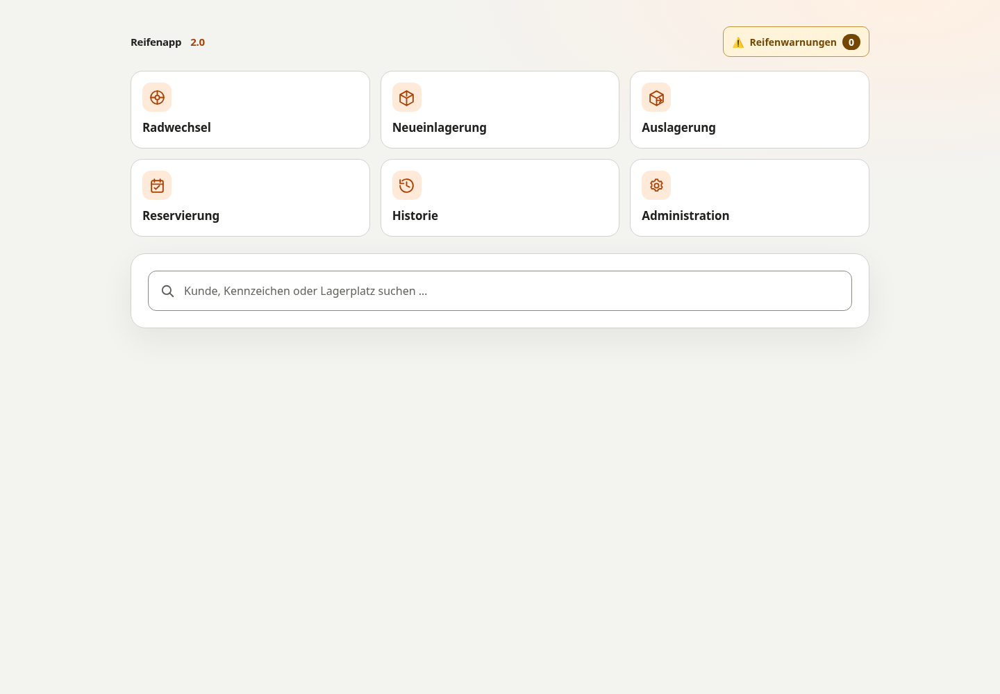

# Reifenapp 2.0

**Reifenlager verwalten. Lokal arbeiten. Daten selbst behalten.**

Eine Open-Source-Reifenlagerverwaltung für Kfz-Werkstätten: Kunden und Lagerplätze
finden, Radsätze einlagern, reservieren und auslagern – mit nachvollziehbarer
Historie und druckbaren DIN-A4-Belegen. Ohne Cloudpflicht.

[Loslegen](#schnellstart) · [Funktionen](#funktionen) · [Dokumentation](#dokumentation) · [Mitmachen](#mitmachen)

**MIT-Lizenz** · **Go ≥ 1.23** · **SQLite** · **HTML, CSS & Vanilla JavaScript**



> **Entwicklungsstand: Beta.** Die aktuelle Entwicklung findet auf
> [`beta`](https://github.com/karst3nl/reifenapp-2/tree/beta) statt. Verwende diesen
> Branch für die unten beschriebenen Funktionen. `main` kann einen älteren Stand enthalten.

## Funktionen

| Bereich | Was bereits funktioniert |
| --- | --- |
| Schnellsuche | Kunden, Kennzeichen, Lagerplätze und Vorgänge suchen – einschließlich abgeschlossener Auslagerungen. |
| Neueinlagerung | Kunden- und Fahrzeugdaten, beide Achsen, Profiltiefen und Zubehör erfassen; Lagerplatz direkt prüfen. |
| Radwechsel | Eigenes Formular mit Reifendaten und eindeutiger Kennzeichnung des Vorgangs im Backend. |
| Reservierung | Freie Lagerplätze für Kunden und Fahrzeuge reservieren; passende Reservierungen bei der Einlagerung übernehmen. |
| Auslagerung | Belegung nach Bestätigung aufheben und den Platz wieder freigeben; Historie erhalten. |
| Druckbelege | Nach jedem erfolgreichen Vorgang automatisch eine einseitige A4-PDF im neuen Tab öffnen; Nachdruck über die Suche. |
| Lagerplatzverwaltung | Lagerorte anlegen, Nummernbereiche ändern und freie, belegte oder reservierte Plätze überblicken. |
| Administration | Getrennte Bereiche für Lagerplätze und passwortgeschützten PDF-Designer mit Drag-and-drop, horizontalem und vertikalem Raster und eigenen Vorlagen je Vorgangsart. |

Aktive Belegungen und Reservierungen dürfen sich nicht überschneiden. Diese Regel
wird auch in der Datenbank abgesichert. Die Ausgangskonfiguration enthält 640 Lagerplätze in den Bereichen
**C1, C2, C3, C4, OL und OR**. Weitere Lagerorte und Zahlenbereiche sind im Adminbereich verwaltbar.

Noch offen sind unter anderem eine eigenständige Historienansicht, CSV-Import und
die Pflege von Auswahllisten im Adminbereich. Die Historie ist bereits über die
Suche erreichbar. Der Radwechsel erfasst aktuell einen eigenen Einlagerungsvorgang;
er tauscht keinen bereits belegten Radsatz automatisch aus. Bilder und Logos im
PDF-Designer folgen später.

## Schnellstart

### CachyOS / Arch Linux

Benötigt werden Git, Go ab Version 1.23 und ein C-Compiler für den SQLite-Treiber.

```sh
sudo pacman -S --needed git go base-devel
git clone https://github.com/karst3nl/reifenapp-2.git
cd reifenapp-2
git switch beta
go mod download
go run . -dev
```

Öffne **[http://127.0.0.1:8080](http://127.0.0.1:8080)** im Browser.
Zum Herunterladen des öffentlichen Repositories ist kein GitHub-Konto nötig.
Beim ersten Einrichten werden die Go-Abhängigkeiten heruntergeladen; der laufende
Betrieb benötigt keine Cloudverbindung und keinen Frontend-Build.

### Entwicklungsdaten oder eigene Daten

| Startbefehl | Datenbank | Inhalt beim ersten Start |
| --- | --- | --- |
| `go run . -dev` | `data/development.sqlite` | Klar gekennzeichnete, fiktive Beispieldaten |
| `go run .` | `data/reifenapp.sqlite` | Leere Datenbank für eigene Einträge |

Bestehende Datenbanken werden weder zurückgesetzt noch erneut mit Beispielen
befüllt. Beide Betriebsarten verwenden getrennte Datenbanken. Entwicklungsdaten
gehören nicht in die produktive Datenbank.

### Administration einrichten

Öffne **Administration** und melde dich bei einer neuen Datenbank mit dem festen
Benutzernamen `admin` und dem Startpasswort `Reifenapp-Start2026!` an.
Beim ersten Login musst du ein eigenes Passwort festlegen, bevor der Adminbereich
freigeschaltet wird. Es wird ausschließlich als bcrypt-Hash lokal gespeichert.

Nach dem Login wählst du zwischen **Lagerplätze** und **PDF-Editor**.
Die [Lagerplatzverwaltung](docs/lagerplaetze.md) zeigt die Belegung und erlaubt neue
Lagerorte sowie Änderungen der Nummernbereiche.

Im [PDF-Designer](docs/pdf-designer.md) kannst du A4-Vorlagen für die einzelnen
Vorgänge gestalten, testen und aktivieren. Das Raster dient nur als Gestaltungshilfe
und wird nicht mitgedruckt.

## Aktualisieren

Beende den laufenden Server mit **Strg+C** und prüfe eigene Codeänderungen mit
`git status`, bevor du aktualisierst:

```sh
git fetch origin
git switch beta
git pull --ff-only origin beta
go run . -dev -migrate
```

Für die Datenbank mit eigenen Einträgen stattdessen `go run . -migrate` verwenden.
Ein erforderliches Schema-Upgrade läuft erst nach Integritätsprüfung und
automatischem, konsistentem Backup. Alle anderen Prozesse mit Zugriff auf diese
Datenbank müssen vorher beendet sein. Anschließend genügt wieder der normale
Startbefehl. Details: [Betrieb und API](docs/betrieb-und-api.md).

## Daten bleiben lokal

SQLite-Datenbanken, WAL-/SHM-Dateien, Backups, lokale Konfigurationen und Geheimnisse
sind über `.gitignore` vom Repository ausgeschlossen. Die App speichert ihre
Laufzeitdaten im Verzeichnis `data/`.

Der Server lauscht standardmäßig nur auf `127.0.0.1`. Der Admin-Login schützt den
Adminbereich; die normalen Werkstattfunktionen haben derzeit keinen Login.
LAN-Betrieb braucht daher ein passend abgesichertes Werkstattnetz. Eine öffentliche
Internetbereitstellung ist nicht der vorgesehene Betriebsmodus.

Der spätere Betrieb auf einem **Raspberry Pi** ist vorgesehen. Wegen CGO empfiehlt
sich zunächst der Build direkt auf dem Gerät mit Go und C-Compiler. Auf echter
Pi-Hardware ist die Anwendung noch nicht geprüft.

## Entwicklung

Ein Go-Webserver liefert API und eingebettete Webdateien aus. SQLite verwendet
WAL und versionierte SQL-Migrationen; erfolgreiche Vorgänge und ihre
Historienschnappschüsse werden gemeinsam gespeichert.

```text
main.go                 Einstiegspunkt, Konfiguration und Webserver
internal/               Datenbank, HTTP-Handler, Modelle und PDF-Erzeugung
web/                    HTML, CSS und Vanilla JavaScript
migrations/             Versionierte SQL-Migrationen
docs/                   Anleitungen, Projektübersicht und Prüfberichte
AGENTS.md               Arbeitsregeln für Beiträge
data/                   Lokale Laufzeitdaten, nicht versioniert
```

Prüfungen und Build aus dem Repository-Stamm:

```sh
go test ./...
go test -race ./...
go vet ./...
go build -o bin/reifenapp .
```

Automatisierte Tests verwenden temporäre Datenbanken und ausschließlich fiktive Daten.

## Dokumentation

- [Betrieb, Datenbank und HTTP-API](docs/betrieb-und-api.md)
- [Lagerorte und Nummernbereiche verwalten](docs/lagerplaetze.md)
- [PDF-Designer und Admin-Einrichtung](docs/pdf-designer.md)
- [Kennzeichen und Landkreis-Auswahl](docs/kennzeichen.md)
- [Fachliche Projektübersicht](docs/projektuebersicht.md) – enthält auch geplante Funktionen
- [Prüfberichte zur Beta](docs/pruefung-beta-formular.md)

## Mitmachen

Fehler gefunden oder eine Idee? Erstelle ein
[Issue](https://github.com/karst3nl/reifenapp-2/issues) mit einer nachvollziehbaren
Beschreibung. Pull Requests bitte gegen **`beta`** richten.

Lies vor Änderungen die [Arbeitsregeln](AGENTS.md), halte Beiträge überschaubar
und führe passende Tests aus. Das bestehende Oberflächendesign bleibt ohne
abgesprochene Änderung erhalten. Verwende in Tests, Screenshots und Fehlerberichten
nur fiktive Daten; veröffentliche keine Kundendaten, Datenbanken, Backups oder Zugangsdaten.

## Lizenz

Der Projektcode steht unter der [MIT-Lizenz](LICENSE) und kann auch kommerziell
verwendet, verändert und weitergegeben werden. Urhebervermerk und Lizenztext müssen
erhalten bleiben. Bibliotheken und eingebettete Schriften unterliegen ihren
eigenen Lizenzen: [Hinweise zu Drittanbietern](THIRD_PARTY_NOTICES.md).
